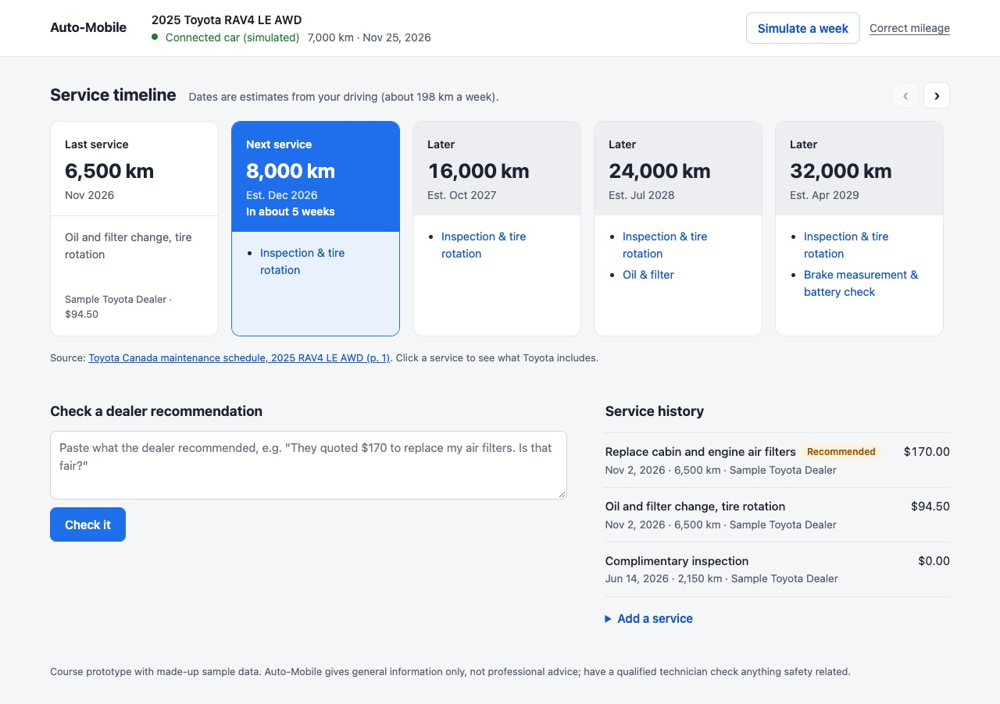

# Auto-Mobile

A maintenance minder for your car. It knows your car's mileage (from a connected car), Toyota's official maintenance
schedule and your service history, and shows what is due now and what comes next. When the dealer recommends work, paste
it in: Auto-Mobile tells you whether it is due, how important it is, whether the price is fair, and how hard it would be to
do yourself.

> **Course prototype (ENTI 633, Fall 2026, Team 5).** The car, its mileage, the service history, the shop and the prices
> are made up. The car connection is simulated. The app has **no login**, so it stores sample data only. Auto-Mobile gives
> general information, not professional advice; check anything safety related with a qualified technician.

## Try it on your own computer

You need a GitHub account that has been **invited to this repository** (it is private; ask Linus or the repository owner).
You do **not** need an API key: without one, the app gives "basic answers" from built-in rules.

### Easiest: let your AI assistant set it up

If you use an AI coding assistant that can run commands on your computer (for example Claude Code), paste this:

> Please set up and start the Auto-Mobile app on my computer so I can test it. The code is in the private GitHub
> repository github.com/ljljlj7/VehicleApp, which I have access to. Follow the steps under "Set it up by hand" in its
> README.md for my operating system. Only install and start the app: do not change, commit or push any project files, and
> do not add an API key. When it is running, open http://localhost:3000 in my browser and tell me in two lines how to stop
> it and how to start it again next time.

If it asks you to sign in to GitHub, do that in the browser window it opens.

### Set it up by hand

**Windows**

1. Install Node.js and Git once (in PowerShell): `winget install --id OpenJS.NodeJS.LTS -e` and `winget install --id Git.Git -e`.
   Close and reopen PowerShell afterwards.
2. Get the code: `git clone https://github.com/ljljlj7/VehicleApp.git`, then `cd VehicleApp`.
3. Install: `npm.cmd install`
4. Start: `npm.cmd start`, then open http://localhost:3000. Stop with Ctrl+C.
   (Use `npm.cmd`, not `npm`: PowerShell blocks plain `npm` by default.)

**Mac**

1. Install Node.js once: the "LTS" installer from https://nodejs.org (or `brew install node`). Git comes with macOS; if
   the Terminal asks to install developer tools, say yes.
2. Get the code (in Terminal): `git clone https://github.com/ljljlj7/VehicleApp.git`, then `cd VehicleApp`.
3. Install: `npm install`
4. Start: `npm start`, then open http://localhost:3000. Stop with Ctrl+C.

**GitHub Codespaces (nothing to install)**

1. On this repository's page: **Code → Codespaces → Create codespace on main**. Wait until the editor has loaded.
2. In the terminal at the bottom, type `npm start`.
3. Open the **Ports** tab, find port 3000 and click the globe icon to open the app in a normal browser tab (the small
   preview inside the editor shows the phone layout). A codespace stops after a while without use; reopen it and type
   `npm start` again.

**Starting again later:** open PowerShell or Terminal, `cd VehicleApp`, then `npm.cmd start` (Windows) or `npm start` (Mac).

**Getting a newer version** (in the `VehicleApp` folder, with the app stopped):
`git checkout -- data/db.json` (drops your test data, which would otherwise block the update), then `git pull`, then
`npm install` (`npm.cmd install` on Windows), then start it as above.

## Testing it

1. Press **Reset demo** (top right) before you start, so the car is at 7,000 km on Nov 25, 2026 with the sample history.
2. Work through the tests in [acceptance-test.md](acceptance-test.md) (T1–T18). What each test should show is written
   down in [test-results.md](test-results.md).
3. Things that are normal, not bugs:
   - Answers say **"Basic answer"** with a yellow note that the AI is not set up. The AI part comes next (milestone M6);
     T13 needs it.
   - The app has its own calendar. It starts on Nov 25, 2026 and moves a week forward each time you press
     **Simulate a week**.
   - Everything you add or click is saved in **your own copy** only. "Report a problem" also saves only in your copy, so
     send problems as a screenshot in the team chat.

## What it does

- **Connected car (simulated):** the top bar shows the car, its mileage and the date. **Simulate a week** drives the car
  200 km further; **Correct mileage** fixes the reading by hand; **Reset demo** puts the sample data back.
- **Service timeline:** like Toyota's own website: the last service visit, the next one (blue, red when overdue) and later
  ones, each with its km and an estimated month from how much you drive. Click a service to see what Toyota includes,
  with a link to Toyota's schedule (PDF).
- **Check a dealer recommendation:** paste what the dealer said, with the price if you have one. You get whether it is due
  according to Toyota's schedule, how important it is, the typical shop price compared with the quote, and a 1–5 DIY
  difficulty. Then choose **Parts & tools to DIY** or **Pricing research**. Nothing is ever approved or booked for you.
  Brakes, tires and other safety items always get a red warning.
- **Service history:** dealer recommendations stay under **Open recommendations** until you **Mark done** or **Decline**
  them. Add a service from a list in two groups: **Scheduled by Toyota** (updates the timeline) and **Repairs and other
  work** (kept in the history only). Every entry can be edited or deleted.

### AI answers and basic answers

- **AI answer** (from milestone M6, needs an API key): Claude (Anthropic) reads the question with the car, its mileage,
  what is due, the history and the owner's manual, searches the web for prices and DIY guides, and links its sources. If
  it is unsure, it asks instead of guessing.
- **Basic answer:** if the AI is not set up, is down, or fails, the app answers from built-in rules and Toyota's schedule,
  and says so in a yellow note. Every answer has a **Report a problem** link.

### Adding an API key (optional)

Create a key at https://platform.claude.com → **Settings → API Keys** and add credits under **Settings → Billing** (API
credits are separate from a Claude.ai subscription). On a laptop, copy `.env.example` to `.env` and put the key after
`ANTHROPIC_API_KEY=`; the `.env` file is never uploaded to GitHub. In Codespaces: GitHub → **Settings → Codespaces →
Secrets → New secret**, name `ANTHROPIC_API_KEY`, repository `ljljlj7/VehicleApp`, then restart the codespace. Never paste
a key into code, chat or GitHub.

## How it is built

| Part | File | What it does |
|------|------|--------------|
| Web server | `server.js` | Serves the page, saves data, checks inputs, picks AI or basic answers, resets the demo |
| Minder | `minder.js` | Works out what is due and when, and builds the timeline (plain code, no AI) |
| Basic advisor | `advisor.js` | Rule-based answers, used when the AI is unavailable |
| AI advisor | `ai.js` | Asks Claude, which uses tools for the car, history, reference data and web search |
| Page | `public/` | The screen (HTML, CSS, JavaScript), desktop first, also works on a phone |
| Toyota schedule (PDF) | `public/docs/` | Toyota Canada's 2025 RAV4 LE AWD maintenance schedule, opened from the timeline |
| Schedule data | `data/schedules.json` | Toyota's schedule converted into data, with page references |
| Owner's manual | `data/manual-rav4-2025.json` | Text of the 2025 RAV4 owner's manual, page by page, for the AI (M6) |
| Reference data | `data/knowledge.json` | Made-up sample prices, DIY ratings, parts and tools |
| Saved data | `data/db.json`, `data/db-sample.json` | The car, its readings, history and reports; the starting copy used by Reset demo |

`manuals/` is not on GitHub: it holds Toyota's original PDFs, which were only needed once for the conversion.
Stack: Node.js with Express, plain HTML/CSS/JavaScript, and the Anthropic SDK. Data is stored in JSON files.

## Known limits

- One car with Toyota's real schedule: the 2025 Toyota RAV4 LE AWD (Canada). The 2026 RAV4 Hybrid is recognised, but its
  schedule is a sample.
- The car connection is simulated, and due points are by km only (Toyota's "or every 6 months" limit is not used).
- Prices, DIY ratings, parts and tools are made-up sample values.
- AI answers are not connected yet (M6).
- No login: everyone using the same running app shares one garage.
- The app does not remember the conversation, and uploading a quote document is not built yet.
- The repository contains Toyota's schedule PDF and manual text, so it must stay private.
