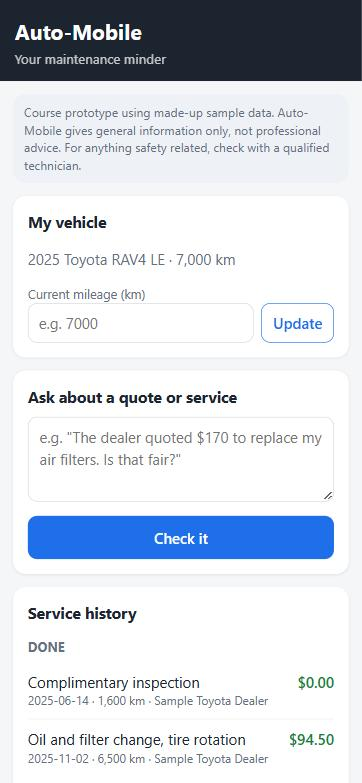

# Auto-Mobile

A personal maintenance minder for your vehicle. Paste a dealer or mechanic recommendation, with the quote if you have one,
and Auto-Mobile tells you whether the work is expected at your mileage, how important it is, whether the price is
reasonable, and how hard it would be to do yourself, with links to its sources.

> **Course prototype (ENTI 633, Fall 2026, Team 5).** All data is made up: the vehicle, the service history, the shop and
> the reference prices. The app has **no login**, so it stores sample data only. Auto-Mobile gives general information,
> not professional advice; check anything safety related with a qualified technician.

## What it does

1. You type or paste a recommendation or question, for example *"The dealer quoted $200 to replace my air filter. Is that worth it?"*
2. The app checks your vehicle, mileage and service history against the maintenance schedule.
3. It shows how important the work is, whether it is due, the typical shop price compared with your quote, and a 1–5 DIY difficulty.
4. It asks if you want more: **Parts & tools to DIY** (with guide links) or **Pricing research** (with price search links). Nothing is ever approved or booked for you.
5. Brakes, tires and other safety items always get a red safety warning.
6. You can update your mileage and add items to your service history; they stay after a reload.

### AI answers and basic answers

- **AI answer:** Claude (Anthropic) reads the question, looks up your vehicle and history, searches the web for the official
  schedule, local prices, forum posts and guides, and links its sources. If it is unsure, it asks you instead of guessing.
- **Basic answer:** if the AI is not set up, is down, or fails, the app answers from built-in sample rules and says so in a
  yellow note. Every answer has a **Report a problem** link; reports are saved for the developers.

## Run it

### Option 1: GitHub Codespaces (recommended, nothing to install)

1. Add the AI key once: GitHub → your profile picture → **Settings → Codespaces → Secrets → New secret**.
   Name `ANTHROPIC_API_KEY`, value: your Anthropic API key, repository access: `ljljlj7/VehicleApp`.
   Skip this to use basic answers only.
2. On this repository's page: **Code → Codespaces → Create codespace on main**. Wait until the editor has loaded.
3. In the terminal at the bottom, type `npm start`. It prints `AI: on` (or `AI: off`). A preview of the app opens.

If you change the secret later, stop and restart the codespace (bottom-left **Codespaces** menu → **Stop Current Codespace**,
then reopen it): a codespace only reads secrets when it starts.

### Option 2: a Windows laptop

1. Install Node.js LTS once: `winget install --id OpenJS.NodeJS.LTS -e`
2. In PowerShell, in the project folder: `npm.cmd install`, then `npm.cmd start`. (Plain `npm` is blocked by PowerShell's
   default script setting; `npm.cmd` avoids that without changing any security setting.)
3. Open http://localhost:3000. Stop with Ctrl+C.
4. Optional AI key: copy `.env.example` to `.env` and put the key after `ANTHROPIC_API_KEY=`. The `.env` file is never uploaded to GitHub.

### Getting an API key

Create one at https://platform.claude.com → **Settings → API Keys** and add credits under **Settings → Billing**.
API credits are separate from a Claude.ai subscription. Never paste the key into code, chat or GitHub, except the Secrets page.

## Tests

- `acceptance-test.md`: the 8 tests the product must pass.
- `test-results.md`: the latest results, with screenshots in `screenshots/`.
- `demo-script.md`: the steps for the laptop demo.

## How it is built

| Part | File | What it does |
|------|------|--------------|
| Web server | `server.js` | Serves the page, saves data, checks inputs, picks AI or basic answers |
| AI advisor | `ai.js` | Asks Claude, which uses tools for the vehicle, history, reference data and web search |
| Basic advisor | `advisor.js` | Rule-based answers from the sample data, used when the AI is unavailable |
| Page | `public/` | The phone-first screen (HTML, CSS, JavaScript) |
| Data | `data/db.json`, `data/knowledge.json` | Sample vehicle, history and reports; sample prices, intervals and DIY ratings |

Stack: Node.js with Express, plain HTML/CSS/JavaScript, and the Anthropic SDK. Data is stored in a JSON file.

## Known limits

- Only two vehicles are covered (2025 Toyota RAV4, 2026 Toyota RAV4 Hybrid) and five services, as a proof of concept.
- Reference prices, intervals and DIY ratings are made-up sample values, not taken from the official manuals.
- No login: everyone who opens the same running app shares one garage. Data saved in a codespace stays in that codespace.
- The app does not remember the conversation: answer a follow-up question by asking again in one line.
- Uploading a quote document is not built yet.
